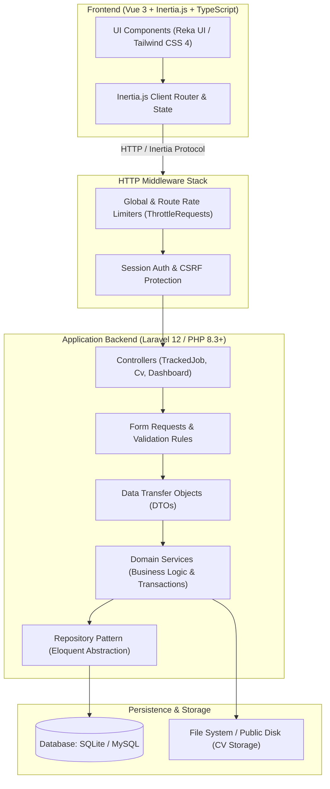
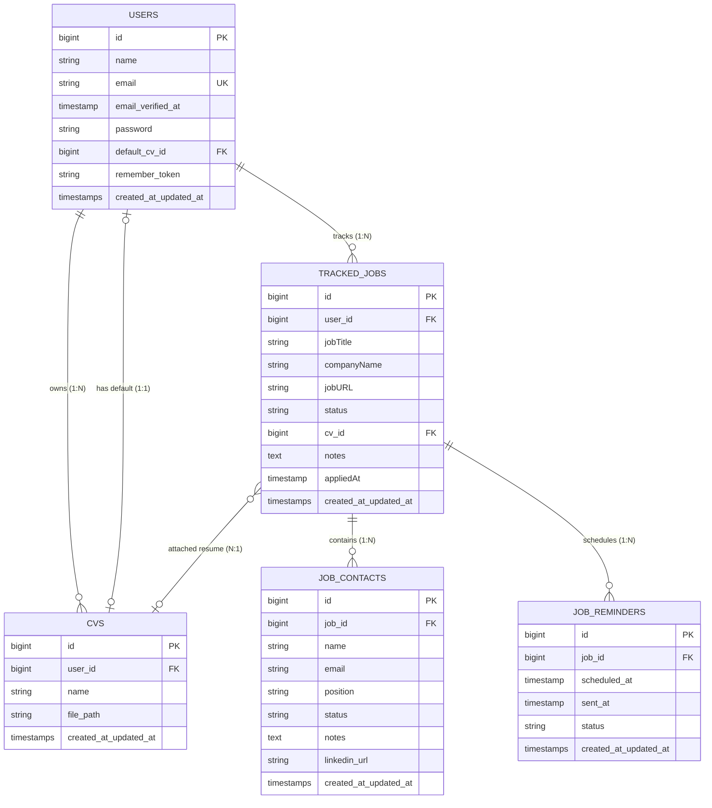

# Jobfolio

<p align="center">
  
</p>

<p align="center">
  <strong>A modern, privacy-focused job application tracker and career pipeline manager.</strong><br>
  Built with Laravel 12, Inertia.js v3, Vue 3, TypeScript, and Tailwind CSS.
</p>

<p align="center">
  <a href="https://jobfolio.cc"></a>
  
  
  
  
  
  
</p>

---

## Table of Contents

- [Live Demo](#live-demo)
- [About The Project](#about-the-project)
- [Key Features](#key-features)
- [System Architecture](#system-architecture)
- [Database Design](#database-design)
- [Technical Highlights & Design Decisions](#technical-highlights--design-decisions)
- [Tech Stack](#tech-stack)
- [Project Structure](#project-structure)
- [Getting Started](#getting-started)
- [Environment Variables](#environment-variables)
- [Testing & Quality Assurance](#testing--quality-assurance)
- [Author & Acknowledgments](#author--acknowledgments)

---

## Live Demo

Experience the live application hosted at:

**[https://jobfolio.cc](https://jobfolio.cc)**

> [!NOTE]
> The live deployment enforces email verification via secure transactional SMTP, CSRF protection, and multi-tier rate limiting. You can freely register your own account using any valid email address to explore the full dashboard and management flows.

---

## About The Project

Job searching is often chaotic, scattered across multiple job boards, spreadsheets, email threads, and recruiter direct messages. Job seekers frequently lose track of where they applied, which resume version they submitted, and who their primary points of contact are.

**Jobfolio** solves this by providing a unified, real-time command center for software engineers and professionals navigating the job market:

- **Centralized Application Pipeline:** Consolidate every job opening across all stages (`Will Apply`, `Applied`, `Interview`, `Offer`, `Rejected`, `No Response`).
- **Targeted Resume Association:** Upload and manage tailored CVs (PDF, DOC, DOCX up to 5MB, max 10 per user), designating default versions or tying specific resumes directly to targeted positions.
- **Outreach & Network Tracking:** Maintain comprehensive contact profiles (recruiters, engineering managers, referrers) with personalized outreach status tracking and direct WhatsApp/LinkedIn integrations.
- **Data-Driven Dashboard:** Monitor search velocity, pipeline health, and response ratios with instant visual feedback and milestone analytics.

---

## Key Features

### 1. Job Application Lifecycle Management

- **Full Application CRUD:** Track job title, company name, direct posting URL or recruiter phone number, application date, and detailed interview notes.
- **Direct WhatsApp Outreach Detection:** Smart resolution automatically detects phone numbers in the job URL field and formats direct one-click WhatsApp chat links (`wa.me`).
- **Inline Status Toggling:** Update stage status directly from table rows without navigating into full edit screens.
- **In-App Deletion Confirmations:** Non-blocking native UI modal dialogs preventing accidental deletions.

### 2. Resume & Document Management (CV Engine)

- **Multi-Resume Storage:** Store up to 10 tailored CV files per user account with custom labels.
- **Strict Validation:** Enforced 5MB file size limits and MIME-type restrictions (`pdf`, `doc`, `docx`).
- **Default Resume Routing:** Automatically attach a designated default resume to new applications, with the ability to upload a new resume inline during job creation.
- **Secure File Isolation:** Managed via Laravel Storage abstraction on protected disks.

### 3. Recruiter & Contact Outreach Tracking

- **Associated Contacts:** Attach unlimited key contacts (recruiters, talent leads, interviewers) to each job application.
- **Outreach Status Tracking:** Track outreach stages: `Will Contact`, `Message Sent`, `Replied`, `No Response`.
- **Atomic Contact Synchronization:** Edit, add, or remove company contacts directly within the job edit workflow backed by database transactions.

### 4. Interactive Analytics & Dashboard

- **Pipeline Breakdown:** Metric cards displaying Total Applications, Active Interviews, Received Offers, and Response Rates.
- **Recent Activity Feed:** Quick-access list of the latest applications with status badges and quick view actions.

### 5. Multi-Tier Security & Rate Limiting

- **Global Throttling:** 120 requests/minute for authenticated users; 60 requests/minute for guest visitors.
- **Upload Guards:** Maximum 10 uploads/minute per user on all file upload endpoints.
- **Auth Protection:** 5 attempts/minute brute-force throttle on `/login`, `/register`, and `/forgot-password`.
- **Session-Based State:** Stateful session cookie authentication powered by Laravel Fortify with strict CSRF protection.

---

## System Architecture

Jobfolio utilizes a hybrid **Monolithic Single Page Application (SPA)** architecture powered by Laravel 12 and Inertia.js v3. This setup delivers the snappy, client-side routing and reactivity of a modern Vue 3 application while maintaining the developer productivity, Eloquent ORM capabilities, and rock-solid routing of a Laravel backend.



### Request Lifecycle

1. **HTTP Request:** The client sends an Inertia request with JSON payloads or FormData.
2. **Middleware & Throttling:** The request passes through global/route-specific rate limiting (`throttle:global`, `throttle:uploads`) and session authentication guards.
3. **Validation & DTO Mapping:** Dedicated `FormRequest` classes validate input parameters, which are mapped into strongly-typed `DTOs` (e.g., `TrackedJobData`, `JobContactData`).
4. **Domain Services:** Services encapsulate business rules, trigger file storage operations, and execute database operations within atomic database transactions (`DB::transaction`).
5. **Repositories:** Concrete Eloquent repositories isolate data retrieval and persistence from business logic.
6. **Inertia Response:** Controllers return Inertia responses that render Vue page components with pristine, type-safe props.

---

## Database Design

Jobfolio's schema ensures strict referential integrity with cascading deletions and indexed relations:



### Key Relational Constraints

- **`users.default_cv_id`**: Foreign key to `cvs.id` with `nullOnDelete()` constraint.
- **`tracked_jobs.user_id`**: Foreign key to `users.id` with `cascadeOnDelete()`.
- **`tracked_jobs.cv_id`**: Foreign key to `cvs.id` with `nullOnDelete()`, ensuring deleting an obsolete resume never destroys job tracking records.
- **`job_contacts.job_id`**: Foreign key to `tracked_jobs.id` with `cascadeOnDelete()`.

---

## Technical Highlights & Design Decisions

### 1. Service-Repository Pattern with DTOs

- **Decoupled Architecture:** Business logic is entirely separated from controllers using `TrackedJobService`, `CvService`, and `DashboardService`.
- **Contracts / Interfaces:** Repositories implement strict interfaces (`TrackedJobRepositoryInterface`, `CvRepositoryInterface`, etc.) bound in `RepositoryServiceProvider`.
- **Data Transfer Objects:** Strict object mapping (`TrackedJobData`, `JobContactData`, `CvUploadData`) guarantees type safety and predictable payloads across application boundaries.

### 2. Atomic Operations & Data Consistency

- Complex multi-entity operations—such as creating a job while uploading a new CV and adding multiple recruiter contacts—are wrapped inside `DB::transaction()` closures to guarantee complete atomicity.

### 3. Modern Frontend Stack (Vue 3 + Tailwind CSS 4)

- **Composition API `<script setup lang="ts">`:** Written cleanly using TypeScript and Vue 3 reactive primitives.
- **Reka UI & Lucide Icons:** Accessible, unstyled UI primitives styled seamlessly with Tailwind CSS 4.
- **Inertia Wayfinder:** Automatic TypeScript route generation providing type-safe autocomplete for application routes.

### 4. Resilient Rate Limiting & Abuse Prevention

- **Tiered Web Rate Limiting:** Global limiter differentiated by authentication state.
- **Storage Protection:** CV upload endpoints are throttled to 10 requests/minute, capped at a maximum of 10 resumes per user and 5MB per file to prevent disk exhaustion.
- **Client-Side Grace:** Inertia `httpException` listeners intercept HTTP 429 status codes and display elegant toast alerts via `vue-sonner`.

---

## Tech Stack

| Category               | Technology                                                                                         | Purpose                                                    |
| :--------------------- | :------------------------------------------------------------------------------------------------- | :--------------------------------------------------------- |
| **Backend Framework**  | [Laravel 12](https://laravel.com)                                                                  | Core API, routing, Eloquent ORM, security, and jobs        |
| **Language**           | [PHP 8.3+](https://www.php.net)                                                                    | Modern typed backend programming language                  |
| **Frontend Adapter**   | [Inertia.js v3](https://inertiajs.com)                                                             | Monolithic SPA architecture connecting Laravel & Vue       |
| **Frontend Framework** | [Vue 3](https://vuejs.org)                                                                         | Declarative Composition API UI components                  |
| **Type Safety**        | [TypeScript 5.2](https://www.typescriptlang.org)                                                   | Type checking across all frontend components and routes    |
| **Styling**            | [Tailwind CSS 4](https://tailwindcss.com)                                                          | Utility-first, high-performance styling engine             |
| **UI Primitives**      | [Reka UI](https://reka-ui.com)                                                                     | Accessible, unstyled accessible UI components              |
| **Authentication**     | [Laravel Fortify](https://laravel.com/docs/fortify)                                                | Headless, secure authentication and password reset backend |
| **Database**           | [SQLite](https://www.sqlite.org) / [MySQL](https://www.mysql.com)                                  | Relational database storage                                |
| **Code Quality**       | [PHPStan / Larastan](https://github.com/larastan/larastan) & [Pint](https://laravel.com/docs/pint) | Static analysis (PHPStan Level 6) and PSR-12 code style    |
| **Testing**            | [PHPUnit 12](https://phpunit.de)                                                                   | Unit and feature automated test suite                      |

---

## Project Structure

```
trackly/
├── app/
│   ├── DTOs/                      # Strongly-typed Data Transfer Objects
│   ├── Enums/                     # PHP Enums (TrackedJobStatus, JobContactStatus)
│   ├── Http/
│   │   ├── Controllers/           # Thin controllers delegating to Services
│   │   ├── Middleware/            # Inertia, appearance, and rate limiting
│   │   └── Requests/              # Form Requests with granular validation rules
│   ├── Models/                    # Eloquent Models (User, TrackedJob, Cv, etc.)
│   ├── Notifications/             # Custom notifications (Password reset, etc.)
│   ├── Providers/                 # Service Providers (App, Repository, Fortify)
│   ├── Repositories/
│   │   ├── Contracts/             # Interface contracts for repositories
│   │   └── Eloquent/              # Concrete Eloquent implementations
│   ├── Rules/                     # Custom validation rules (UrlOrWhatsApp)
│   └── Services/                  # Business logic & transaction orchestration
├── bootstrap/
│   └── app.php                    # Laravel application bootstrap & middleware aliases
├── config/                        # Laravel & package configurations
├── database/
│   ├── factories/                 # Eloquent model factories
│   ├── migrations/                # Database schema migrations
│   └── seeders/                   # Development database seeders
├── resources/
│   ├── css/                       # Global Tailwind CSS 4 style configurations
│   └── js/
│       ├── components/            # Reusable UI component library (Reka UI / UI)
│       ├── layouts/               # App and Auth Inertia layout wrappers
│       ├── lib/                   # Utilities, formatters, and toast listeners
│       ├── pages/                 # Inertia page views (Dashboard, jobs, cvs, auth)
│       ├── routes/                # Wayfinder generated route bindings
│       └── types/                 # Shared TypeScript interfaces
├── routes/
│   ├── console.php                # Artisan commands
│   ├── settings.php               # User settings and appearance routes
│   └── web.php                    # Application web routes and middlewares
└── tests/
    ├── Feature/                   # Comprehensive feature tests (CRUD, Auth, CVs)
    └── Unit/                      # Unit test coverage
```

---

## Getting Started

### Prerequisites

- **PHP**: `^8.3` (with `pdo`, `mbstring`, `fileinfo`, `openssl`, `tokenizer`, `xml`)
- **Composer**: `^2.x`
- **Node.js**: `^20.x` or `^22.x`
- **NPM**: `^10.x`

### Installation Steps

1. **Clone the repository:**

    ```bash
    git clone https://github.com/Kadry333/Trackly.git
    cd Trackly
    ```

2. **Install PHP dependencies:**

    ```bash
    composer install
    ```

3. **Install JavaScript dependencies:**

    ```bash
    npm install
    ```

4. **Configure environment:**

    ```bash
    cp .env.example .env
    php artisan key:generate
    ```

5. **Set up the database and run migrations:**

    ```bash
    touch database/database.sqlite
    php artisan migrate --seed
    ```

6. **Create symbolic link for storage (CV file uploads):**

    ```bash
    php artisan storage:link
    ```

7. **Start local development servers:**
   In one terminal, run the Laravel development server:

    ```bash
    php artisan serve
    ```

    In a second terminal, run the Vite development server:

    ```bash
    npm run dev
    ```

    Open your browser and navigate to **`http://localhost:8000`**.

---

## Environment Variables

Jobfolio works out-of-the-box with standard SQLite configuration. For production deployments, adjust the following environment parameters:

```dotenv
APP_NAME=Jobfolio
APP_ENV=local
APP_KEY=base64:...
APP_DEBUG=true
APP_URL=http://localhost:8000

# Database Configuration (SQLite default; MySQL supported)
DB_CONNECTION=sqlite
# DB_CONNECTION=mysql
# DB_HOST=127.0.0.1
# DB_PORT=3306
# DB_DATABASE=jobfolio
# DB_USERNAME=root
# DB_PASSWORD=

# Session & Cache
SESSION_DRIVER=database
CACHE_STORE=database
QUEUE_CONNECTION=database

# File Storage
FILESYSTEM_DISK=public

# Mail Configuration (SMTP)
MAIL_MAILER=smtp
MAIL_HOST=mail.jobfolio.cc
MAIL_PORT=465
MAIL_USERNAME=noreply@jobfolio.cc
MAIL_PASSWORD="your-mail-password"
MAIL_ENCRYPTION=ssl
MAIL_FROM_ADDRESS="noreply@jobfolio.cc"
MAIL_FROM_NAME="${APP_NAME}"
```

---

## Testing & Quality Assurance

The project enforces high code quality through continuous automated verification:

### 1. Run Automated Test Suite (PHPUnit)

All feature workflows, validation rules, authentication barriers, and contact synchronizations are thoroughly tested:

```bash
./vendor/bin/phpunit
```

### 2. Static Analysis (PHPStan / Larastan)

Verify zero type regressions and strict type checks:

```bash
composer analyze
```

### 3. Code Style & Linting (Laravel Pint)

Ensure all PHP code adheres to standard styling:

```bash
./vendor/bin/pint --test
```

### 4. Frontend Type Checking & Formatting

```bash
npm run types:check
npm run check
```

### 5. Unified CI Verification

Run the entire test and quality pipeline in one command:

```bash
composer ci:check
```

---

## Author & Acknowledgments

**Kareem Kadry**

- **GitHub:** [https://github.com/Kadry333](https://github.com/Kadry333)
- **LinkedIn:** [https://www.linkedin.com/in/kareem-kadry/](https://www.linkedin.com/in/kareem-kadry/)
- **Portfolio:** [https://kareem-kadry.vercel.app/](https://kareem-kadry.vercel.app/)

---

<p align="center">
  Licensed under the <a href="LICENSE">MIT License</a>.
</p>
